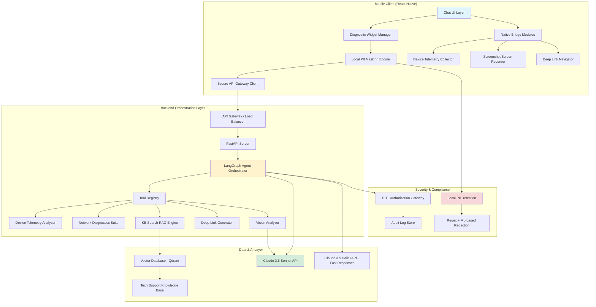
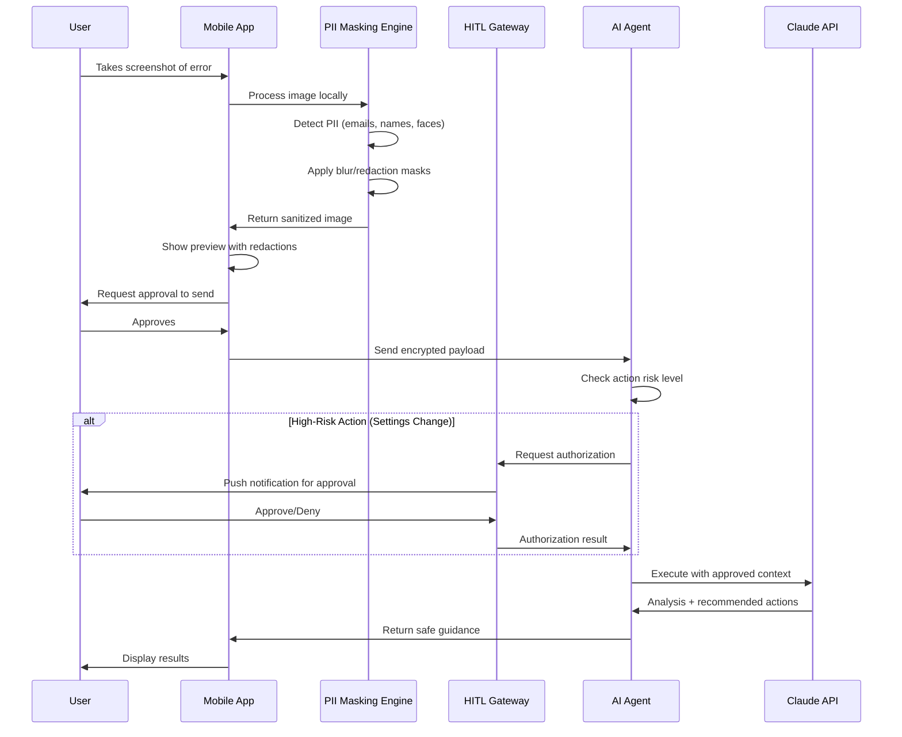

# AI-Powered Pocket Mobile Tech Support Agent
## Complete Technical Specification & Implementation Guide

**Document Version:** 1.0  
**Last Updated:** October 11, 2026  
**Target Platform:** iOS & Android (React Native)  
**Backend Stack:** Python FastAPI + LangGraph  
**Primary LLM:** Anthropic Claude 3.5 Sonnet/Haiku

---

## Table of Contents
1. [Phase 1: High-Level System Architecture](#phase-1-high-level-system-architecture)
2. [Phase 2: Tech Stack & Project Setup](#phase-2-tech-stack--project-setup)
3. [Phase 3: Core Mobile Client Implementation](#phase-3-core-mobile-client-implementation)
4. [Phase 4: Backend Orchestration & Agent Tools](#phase-4-backend-orchestration--agent-tools)
5. [Phase 5: Step-by-Step Build & Deployment Plan](#phase-5-step-by-step-build--deployment-plan)

---

## Phase 1: High-Level System Architecture

### 1.1 System Architecture Overview



### 1.2 Security & Privacy Architecture Flow



### 1.3 Core Data Flow Architecture

**Diagnostic Session Flow:**
1. User initiates chat with issue description
2. Agent analyzes natural language intent
3. Agent determines required diagnostic tools
4. Mobile client executes safe telemetry collection
5. Data flows through PII masking pipeline
6. Backend agent orchestrates multi-step reasoning:
   - Query vector DB for similar issues
   - Analyze device telemetry patterns
   - Request screenshot if visual context needed
   - Generate actionable remediation steps
7. Response includes interactive cards (deep links, run diagnostics button)
8. HITL checkpoint for destructive actions
9. Audit trail persisted for compliance

---

## Phase 2: Tech Stack & Project Setup

### 2.1 Technology Stack Breakdown

#### Mobile Client Stack
```yaml
Framework: React Native 0.74+ (Expo SDK 51+ or bare workflow)
Language: TypeScript 5.3+
State Management: Zustand (lightweight) + React Query (server state)
UI Components: 
  - React Native Paper (Material Design)
  - React Native Reanimated 3 (animations)
Navigation: React Navigation 6.x
Native Modules:
  - react-native-device-info: Hardware specs
  - @react-native-community/netinfo: Network state
  - expo-device: Device identifiers
  - react-native-fs: File system access
  - react-native-permissions: Runtime permissions
  - react-native-vision-camera: Screenshot capture
  - react-native-blob-util: Secure file handling
Encryption: 
  - react-native-encrypted-storage: Secure token storage
  - expo-crypto: Client-side hashing
Testing:
  - Jest + React Native Testing Library
  - Detox (E2E testing)
```

#### Backend Stack
```yaml
API Framework: FastAPI 0.110+ (Python 3.11+)
Agent Orchestration: LangGraph 0.2+
Vector Database: Qdrant 1.9+ (self-hosted or cloud)
LLM Integration: Anthropic SDK 0.32+
Additional Libraries:
  - Pydantic 2.x: Schema validation
  - SQLAlchemy 2.x + PostgreSQL: Audit logs
  - Redis: Session caching
  - Celery: Async task queue
  - python-multipart: File uploads
  - Pillow + pytesseract: Local image preprocessing
  - spacy: PII detection (en_core_web_lg model)
Monitoring:
  - Prometheus + Grafana
  - Sentry (error tracking)
Security:
  - python-jose: JWT tokens
  - bcrypt: Password hashing
  - cryptography: Payload encryption
Testing:
  - pytest + pytest-asyncio
  - httpx (async HTTP client for tests)
```

#### Infrastructure & DevOps
```yaml
Mobile CI/CD: 
  - EAS Build (Expo) / Fastlane (bare RN)
  - GitHub Actions
Backend Hosting:
  - AWS ECS Fargate / Google Cloud Run
  - Vector DB: Qdrant Cloud or self-hosted k8s
CDN: CloudFlare (API gateway protection)
Monitoring: DataDog or New Relic APM
```

### 2.2 Project Folder Structure

```
tech-support-agent/
├── mobile/                          # React Native App
│   ├── src/
│   │   ├── components/
│   │   │   ├── chat/
│   │   │   │   ├── ChatMessage.tsx
│   │   │   │   ├── ChatInput.tsx
│   │   │   │   └── MessageBubble.tsx
│   │   │   ├── diagnostic-cards/
│   │   │   │   ├── TelemetryCard.tsx
│   │   │   │   ├── NetworkTestCard.tsx
│   │   │   │   ├── DeepLinkActionCard.tsx
│   │   │   │   └── ScreenshotAnalysisCard.tsx
│   │   │   └── pii-masking/
│   │   │       ├── PIIMaskingPreview.tsx
│   │   │       └── RedactionOverlay.tsx
│   │   ├── services/
│   │   │   ├── api/
│   │   │   │   ├── agentClient.ts
│   │   │   │   └── types.ts
│   │   │   ├── telemetry/
│   │   │   │   ├── DeviceTelemetryService.ts
│   │   │   │   ├── NetworkDiagnostics.ts
│   │   │   │   └── types.ts
│   │   │   ├── pii-masking/
│   │   │   │   ├── PIIDetector.ts
│   │   │   │   └── ImageRedactor.ts
│   │   │   └── deep-linking/
│   │   │       ├── DeepLinkNavigator.ts
│   │   │       └── platformMaps.ts
│   │   ├── native-modules/
│   │   │   ├── DeviceInfoBridge.ts
│   │   │   └── SystemSettingsModule/ (iOS/Android native code)
│   │   ├── store/
│   │   │   ├── chatStore.ts
│   │   │   ├── diagnosticStore.ts
│   │   │   └── authStore.ts
│   │   ├── hooks/
│   │   │   ├── useTelemetry.ts
│   │   │   ├── useChat.ts
│   │   │   └── useScreenshot.ts
│   │   ├── screens/
│   │   │   ├── ChatScreen.tsx
│   │   │   ├── DiagnosticDashboard.tsx
│   │   │   └── SettingsScreen.tsx
│   │   ├── navigation/
│   │   │   └── RootNavigator.tsx
│   │   ├── utils/
│   │   │   ├── encryption.ts
│   │   │   └── validators.ts
│   │   └── types/
│   │       └── index.ts
│   ├── ios/                         # iOS Native Modules
│   ├── android/                     # Android Native Modules
│   ├── app.json
│   ├── package.json
│   └── tsconfig.json
│
├── backend/                         # Python Backend
│   ├── app/
│   │   ├── main.py                 # FastAPI entry point
│   │   ├── config.py               # Environment config
│   │   ├── api/
│   │   │   ├── routes/
│   │   │   │   ├── agent.py        # Agent chat endpoint
│   │   │   │   ├── diagnostics.py  # Direct diagnostic APIs
│   │   │   │   └── auth.py
│   │   │   └── middleware/
│   │   │       ├── auth.py
│   │   │       └── rate_limit.py
│   │   ├── agent/
│   │   │   ├── orchestrator.py     # LangGraph state machine
│   │   │   ├── state.py            # Agent state schema
│   │   │   ├── tools/
│   │   │   │   ├── __init__.py
│   │   │   │   ├── device_telemetry.py
│   │   │   │   ├── network_diagnostics.py
│   │   │   │   ├── kb_search.py
│   │   │   │   ├── screenshot_analyzer.py
│   │   │   │   └── deep_link_generator.py
│   │   │   └── prompts/
│   │   │       ├── system_prompt.py
│   │   │       └── tool_descriptions.py
│   │   ├── services/
│   │   │   ├── llm_client.py       # Anthropic API wrapper
│   │   │   ├── vector_store.py     # Qdrant client
│   │   │   └── pii_filter.py       # Server-side PII check
│   │   ├── models/
│   │   │   ├── chat.py
│   │   │   ├── diagnostic.py
│   │   │   └── audit.py
│   │   ├── db/
│   │   │   ├── session.py
│   │   │   └── migrations/
│   │   └── utils/
│   │       ├── security.py
│   │       └── validators.py
│   ├── tests/
│   │   ├── test_agent.py
│   │   ├── test_tools.py
│   │   └── test_api.py
│   ├── scripts/
│   │   ├── ingest_kb.py           # RAG knowledge ingestion
│   │   └── setup_db.py
│   ├── requirements.txt
│   ├── pyproject.toml
│   └── Dockerfile
│
├── shared/
│   └── schemas/                    # Shared type definitions
│       ├── agent_protocol.ts
│       └── agent_protocol.py
│
├── infrastructure/
│   ├── terraform/
│   │   ├── main.tf
│   │   ├── ecs.tf
│   │   └── qdrant.tf
│   └── k8s/
│       ├── backend-deployment.yaml
│       └── qdrant-deployment.yaml
│
├── docs/
│   ├── API.md
│   ├── ARCHITECTURE.md
│   └── SECURITY.md
│
├── .github/
│   └── workflows/
│       ├── mobile-ci.yml
│       └── backend-ci.yml
│
└── README.md
```

### 2.3 Initial Project Setup Commands

```bash
# Create root project directory
mkdir tech-support-agent
cd tech-support-agent

# Initialize mobile app (Expo)
npx create-expo-app@latest mobile --template expo-template-blank-typescript

# Or for bare React Native:
npx react-native@latest init mobile --template react-native-template-typescript

# Initialize backend
mkdir backend
cd backend
python -m venv venv
source venv/bin/activate  # On Windows: venv\Scripts\activate
pip install fastapi uvicorn langgraph anthropic qdrant-client pydantic sqlalchemy redis celery pillow spacy python-multipart python-jose[cryptography] pytest httpx

# Download spaCy model for PII detection
python -m spacy download en_core_web_lg

# Initialize backend structure
mkdir -p app/{api/{routes,middleware},agent/{tools,prompts},services,models,db,utils}
touch app/main.py app/config.py

# Create shared schemas directory
mkdir -p shared/schemas

# Initialize git
git init
```

---

## Phase 3: Core Mobile Client Implementation

### 3.1 Device Telemetry Service (TypeScript)

```typescript
// mobile/src/services/telemetry/DeviceTelemetryService.ts
import DeviceInfo from 'react-native-device-info';
import NetInfo from '@react-native-community/netinfo';
import { Platform } from 'react-native';
import * as Device from 'expo-device';
import RNFS from 'react-native-fs';

export interface DeviceTelemetry {
  device: {
    manufacturer: string;
    model: string;
    osVersion: string;
    platform: 'ios' | 'android';
    deviceId: string; // hashed for privacy
  };
  battery: {
    level: number;
    isCharging: boolean;
    batteryHealth?: 'good' | 'degraded' | 'unknown';
  };
  storage: {
    totalSpace: number;
    freeSpace: number;
    usedPercentage: number;
  };
  memory: {
    totalRAM: number;
    usedRAM?: number;
  };
  network: {
    isConnected: boolean;
    type: string;
    isInternetReachable: boolean;
    ipAddress?: string;
    ssid?: string; // Wi-Fi name (requires permission)
  };
  timestamp: string;
}

class DeviceTelemetryService {
  /**
   * Collect comprehensive device telemetry
   * All PII (like device serial) is hashed locally
   */
  async collectTelemetry(): Promise<DeviceTelemetry> {
    try {
      const [
        batteryLevel,
        isCharging,
        netInfo,
        totalSpace,
        freeSpace,
        totalMemory,
      ] = await Promise.all([
        DeviceInfo.getBatteryLevel(),
        DeviceInfo.isBatteryCharging(),
        NetInfo.fetch(),
        DeviceInfo.getTotalDiskCapacity(),
        DeviceInfo.getFreeDiskStorage(),
        DeviceInfo.getTotalMemory(),
      ]);

      // Hash device ID for privacy
      const uniqueId = await DeviceInfo.getUniqueId();
      const hashedId = await this.hashDeviceId(uniqueId);

      const telemetry: DeviceTelemetry = {
        device: {
          manufacturer: await DeviceInfo.getManufacturer(),
          model: DeviceInfo.getModel(),
          osVersion: DeviceInfo.getSystemVersion(),
          platform: Platform.OS as 'ios' | 'android',
          deviceId: hashedId,
        },
        battery: {
          level: Math.round(batteryLevel * 100),
          isCharging,
          batteryHealth: await this.estimateBatteryHealth(batteryLevel),
        },
        storage: {
          totalSpace: Math.round(totalSpace / (1024 ** 3)), // GB
          freeSpace: Math.round(freeSpace / (1024 ** 3)),
          usedPercentage: Math.round(((totalSpace - freeSpace) / totalSpace) * 100),
        },
        memory: {
          totalRAM: Math.round(totalMemory / (1024 ** 3)),
        },
        network: {
          isConnected: netInfo.isConnected ?? false,
          type: netInfo.type,
          isInternetReachable: netInfo.isInternetReachable ?? false,
          ipAddress: netInfo.details?.ipAddress,
          ssid: netInfo.details?.ssid, // Only available with location permission
        },
        timestamp: new Date().toISOString(),
      };

      return telemetry;
    } catch (error) {
      console.error('Error collecting telemetry:', error);
      throw error;
    }
  }

  /**
   * Hash device ID using SHA-256 for privacy
   */
  private async hashDeviceId(deviceId: string): Promise<string> {
    const { digest } = await import('expo-crypto');
    return await digest('SHA256', deviceId);
  }

  /**
   * Estimate battery health based on charge patterns
   * (Simplified - production would track historical data)
   */
  private async estimateBatteryHealth(
    currentLevel: number
  ): Promise<'good' | 'degraded' | 'unknown'> {
    if (Platform.OS === 'android') {
      // Android provides battery health status
      const batteryHealth = await DeviceInfo.getBatteryHealth();
      if (batteryHealth === 'BATTERY_HEALTH_GOOD') return 'good';
      if (batteryHealth === 'BATTERY_HEALTH_DEAD' || 
          batteryHealth === 'BATTERY_HEALTH_OVER_VOLTAGE') return 'degraded';
    }
    return 'unknown';
  }

  /**
   * Run quick storage diagnostics
   */
  async diagnoseStorageIssues(): Promise<{
    status: 'healthy' | 'warning' | 'critical';
    message: string;
    freeSpaceGB: number;
  }> {
    const freeSpace = await DeviceInfo.getFreeDiskStorage();
    const freeSpaceGB = Math.round(freeSpace / (1024 ** 3));

    if (freeSpaceGB < 1) {
      return {
        status: 'critical',
        message: 'Storage critically low. Delete unused apps or media.',
        freeSpaceGB,
      };
    } else if (freeSpaceGB < 5) {
      return {
        status: 'warning',
        message: 'Storage running low. Consider freeing up space.',
        freeSpaceGB,
      };
    }

    return {
      status: 'healthy',
      message: 'Storage levels are healthy.',
      freeSpaceGB,
    };
  }
}

export default new DeviceTelemetryService();
```

### 3.2 Network Diagnostics Module

```typescript
// mobile/src/services/telemetry/NetworkDiagnostics.ts
import NetInfo, { NetInfoState } from '@react-native-community/netinfo';
import { Platform } from 'react-native';

export interface NetworkDiagnosticResult {
  connectivity: {
    isConnected: boolean;
    type: string;
    strength?: number; // Signal strength (0-100)
  };
  latency?: number; // Ping time in ms
  dns: {
    resolves: boolean;
    latency?: number;
  };
  recommendation: string;
  timestamp: string;
}

class NetworkDiagnostics {
  /**
   * Run comprehensive network diagnostics
   */
  async runDiagnostics(): Promise<NetworkDiagnosticResult> {
    const netInfo = await NetInfo.fetch();
    
    const [pingResult, dnsResult] = await Promise.all([
      this.measureLatency(),
      this.testDNSResolution(),
    ]);

    const result: NetworkDiagnosticResult = {
      connectivity: {
        isConnected: netInfo.isConnected ?? false,
        type: netInfo.type,
        strength: await this.getSignalStrength(netInfo),
      },
      latency: pingResult.latency,
      dns: dnsResult,
      recommendation: this.generateRecommendation(netInfo, pingResult, dnsResult),
      timestamp: new Date().toISOString(),
    };

    return result;
  }

  /**
   * Measure network latency by timing a HEAD request
   */
  private async measureLatency(): Promise<{ latency?: number; success: boolean }> {
    try {
      const start = Date.now();
      const response = await fetch('https://www.google.com/generate_204', {
        method: 'HEAD',
        cache: 'no-cache',
      });
      const latency = Date.now() - start;
      return { latency, success: response.ok };
    } catch (error) {
      return { success: false };
    }
  }

  /**
   * Test DNS resolution by attempting to resolve a known domain
   */
  private async testDNSResolution(): Promise<{ resolves: boolean; latency?: number }> {
    try {
      const start = Date.now();
      await fetch('https://dns.google/resolve?name=google.com&type=A', {
        method: 'GET',
      });
      const latency = Date.now() - start;
      return { resolves: true, latency };
    } catch (error) {
      return { resolves: false };
    }
  }

  /**
   * Get Wi-Fi signal strength (Android only via native module)
   */
  private async getSignalStrength(netInfo: NetInfoState): Promise<number | undefined> {
    if (Platform.OS === 'android' && netInfo.type === 'wifi') {
      // This would require a native module to access WifiManager
      // For now, return undefined
      return undefined;
    }
    return undefined;
  }

  /**
   * Generate actionable recommendation based on diagnostic results
   */
  private generateRecommendation(
    netInfo: NetInfoState,
    pingResult: { latency?: number; success: boolean },
    dnsResult: { resolves: boolean }
  ): string {
    if (!netInfo.isConnected) {
      return 'No network connection. Check if Wi-Fi or mobile data is enabled.';
    }

    if (!dnsResult.resolves) {
      return 'DNS resolution failing. Try switching DNS servers or reconnecting.';
    }

    if (pingResult.latency && pingResult.latency > 500) {
      return 'High latency detected. Move closer to Wi-Fi router or switch to mobile data.';
    }

    if (netInfo.type === 'wifi' && !netInfo.details?.ssid) {
      return 'Connected to Wi-Fi but network details unavailable. Check router settings.';
    }

    return 'Network connection is healthy.';
  }

  /**
   * Subscribe to real-time network changes
   */
  subscribeToNetworkChanges(
    callback: (state: NetInfoState) => void
  ): () => void {
    return NetInfo.addEventListener(callback);
  }
}

export default new NetworkDiagnostics();
```

### 3.3 Deep Link Navigation Module

```typescript
// mobile/src/services/deep-linking/DeepLinkNavigator.ts
import { Linking, Platform, Alert } from 'react-native';

/**
 * Maps troubleshooting actions to native OS deep links
 */
export const DEEP_LINK_ACTIONS = {
  // iOS Settings
  ios: {
    wifi: 'App-Prefs:WIFI',
    bluetooth: 'App-Prefs:Bluetooth',
    cellular: 'App-Prefs:MOBILE_DATA',
    battery: 'App-Prefs:BATTERY_USAGE',
    storage: 'App-Prefs:General&path=STORAGE_MGMT',
    appPermissions: 'app-settings:', // Opens this app's settings
    notifications: 'App-Prefs:NOTIFICATIONS_ID',
    location: 'App-Prefs:Privacy&path=LOCATION',
    reset: 'App-Prefs:General&path=Reset',
  },
  // Android Intents
  android: {
    wifi: 'android.settings.WIFI_SETTINGS',
    bluetooth: 'android.settings.BLUETOOTH_SETTINGS',
    cellular: 'android.settings.DATA_ROAMING_SETTINGS',
    battery: 'android.settings.BATTERY_SAVER_SETTINGS',
    storage: 'android.settings.INTERNAL_STORAGE_SETTINGS',
    appPermissions: 'android.settings.APPLICATION_DETAILS_SETTINGS',
    notifications: 'android.settings.APP_NOTIFICATION_SETTINGS',
    location: 'android.settings.LOCATION_SOURCE_SETTINGS',
    apps: 'android.settings.APPLICATION_SETTINGS',
  },
};

interface DeepLinkAction {
  action: keyof typeof DEEP_LINK_ACTIONS.ios | keyof typeof DEEP_LINK_ACTIONS.android;
  label: string;
  description: string;
}

class DeepLinkNavigator {
  /**
   * Open native settings page for a specific action
   */
  async openSettings(action: DeepLinkAction['action']): Promise<boolean> {
    try {
      if (Platform.OS === 'ios') {
        const url = DEEP_LINK_ACTIONS.ios[action as keyof typeof DEEP_LINK_ACTIONS.ios];
        if (!url) {
          console.warn(`iOS deep link not found for action: ${action}`);
          return false;
        }
        await Linking.openURL(url);
        return true;
      } else {
        const intentAction = DEEP_LINK_ACTIONS.android[
          action as keyof typeof DEEP_LINK_ACTIONS.android
        ];
        if (!intentAction) {
          console.warn(`Android intent not found for action: ${action}`);
          return false;
        }

        // For Android, we need to use native module to fire intents
        // This is a simplified version - production would use a proper native module
        const url = `intent://#Intent;action=${intentAction};end`;
        await Linking.openURL(url);
        return true;
      }
    } catch (error) {
      console.error('Error opening settings:', error);
      return false;
    }
  }

  /**
   * Generate a deep link action card for the chat UI
   */
  generateActionCard(
    issue: string,
    action: DeepLinkAction['action']
  ): DeepLinkAction {
    const actionMap: Record<string, DeepLinkAction> = {
      wifi: {
        action: 'wifi',
        label: 'Open Wi-Fi Settings',
        description: 'Configure your Wi-Fi connection',
      },
      battery: {
        action: 'battery',
        label: 'Check Battery Settings',
        description: 'View battery usage and optimization options',
      },
      storage: {
        action: 'storage',
        label: 'Manage Storage',
        description: 'Free up space by deleting unused files',
      },
      appPermissions: {
        action: 'appPermissions',
        label: 'Review App Permissions',
        description: 'Grant necessary permissions for this app',
      },
    };

    return (
      actionMap[action] || {
        action,
        label: 'Open Settings',
        description: 'Navigate to relevant settings page',
      }
    );
  }

  /**
   * Validate if a deep link can be opened
   */
  async canOpenDeepLink(action: DeepLinkAction['action']): Promise<boolean> {
    try {
      const url =
        Platform.OS === 'ios'
          ? DEEP_LINK_ACTIONS.ios[action as keyof typeof DEEP_LINK_ACTIONS.ios]
          : `intent://#Intent;action=${
              DEEP_LINK_ACTIONS.android[action as keyof typeof DEEP_LINK_ACTIONS.android]
            };end`;

      if (!url) return false;
      return await Linking.canOpenURL(url);
    } catch {
      return false;
    }
  }

  /**
   * Open settings with user confirmation
   */
  async openWithConfirmation(
    action: DeepLinkAction['action'],
    message: string
  ): Promise<void> {
    Alert.alert(
      'Open Settings',
      message,
      [
        { text: 'Cancel', style: 'cancel' },
        {
          text: 'Open',
          onPress: async () => {
            const success = await this.openSettings(action);
            if (!success) {
              Alert.alert('Error', 'Could not open settings. Please navigate manually.');
            }
          },
        },
      ],
      { cancelable: true }
    );
  }
}

export default new DeepLinkNavigator();
```

### 3.4 PII Masking Engine (Client-Side)

```typescript
// mobile/src/services/pii-masking/PIIDetector.ts
import { Image } from 'react-native';

export interface PIIDetectionResult {
  hasPII: boolean;
  detectedTypes: PIIType[];
  redactionBoxes: RedactionBox[];
}

export type PIIType = 'email' | 'phone' | 'ssn' | 'creditCard' | 'password' | 'name';

export interface RedactionBox {
  x: number;
  y: number;
  width: number;
  height: number;
  type: PIIType;
}

class PIIDetector {
  // Regex patterns for common PII
  private readonly patterns = {
    email: /\b[A-Za-z0-9._%+-]+@[A-Za-z0-9.-]+\.[A-Z|a-z]{2,}\b/g,
    phone: /\b(\+?1[-.]?)?\(?\d{3}\)?[-.]?\d{3}[-.]?\d{4}\b/g,
    ssn: /\b\d{3}-\d{2}-\d{4}\b/g,
    creditCard: /\b(?:\d{4}[-\s]?){3}\d{4}\b/g,
    // Simplified password detection (looks for common labels)
    password: /\b(password|passwd|pwd)[:=\s]+\S+/gi,
  };

  /**
   * Detect PII in text content (from OCR or user input)
   */
  detectInText(text: string): PIIDetectionResult {
    const detectedTypes: PIIType[] = [];
    const redactionBoxes: RedactionBox[] = [];

    for (const [type, pattern] of Object.entries(this.patterns)) {
      const matches = text.match(pattern);
      if (matches && matches.length > 0) {
        detectedTypes.push(type as PIIType);
      }
    }

    return {
      hasPII: detectedTypes.length > 0,
      detectedTypes,
      redactionBoxes, // Would be populated by OCR + bounding box detection
    };
  }

  /**
   * Redact PII from text
   */
  redactText(text: string): string {
    let redacted = text;
    
    for (const pattern of Object.values(this.patterns)) {
      redacted = redacted.replace(pattern, '[REDACTED]');
    }

    return redacted;
  }

  /**
   * Analyze screenshot for PII (simplified - production would use ML model)
   * In production, this would:
   * 1. Run on-device OCR (ML Kit or Tesseract)
   * 2. Detect text regions with bounding boxes
   * 3. Apply PII regex to OCR'd text
   * 4. Return boxes for visual redaction overlay
   */
  async detectInScreenshot(imageUri: string): Promise<PIIDetectionResult> {
    // Placeholder - would integrate with ML Kit or TensorFlow Lite
    // For now, return mock result
    
    return {
      hasPII: false,
      detectedTypes: [],
      redactionBoxes: [],
    };
  }

  /**
   * Generate blur/redaction mask for image
   */
  applyRedactionMask(
    imageUri: string,
    redactionBoxes: RedactionBox[]
  ): Promise<string> {
    // This would use react-native-image-manipulator or similar
    // to blur specific regions of the image
    throw new Error('Not implemented - use react-native-image-manipulator');
  }
}

export default new PIIDetector();
```

### 3.5 Chat UI with Diagnostic Cards

```typescript
// mobile/src/components/diagnostic-cards/DeepLinkActionCard.tsx
import React from 'react';
import { View, Text, TouchableOpacity, StyleSheet } from 'react-native';
import { Card, Button } from 'react-native-paper';
import Icon from 'react-native-vector-icons/MaterialCommunityIcons';
import DeepLinkNavigator from '../../services/deep-linking/DeepLinkNavigator';

interface DeepLinkActionCardProps {
  action: {
    type: string;
    label: string;
    description: string;
    deepLink: string;
  };
}

export const DeepLinkActionCard: React.FC<DeepLinkActionCardProps> = ({ action }) => {
  const handlePress = async () => {
    await DeepLinkNavigator.openSettings(action.deepLink as any);
  };

  return (
    <Card style={styles.card} elevation={2}>
      <Card.Content>
        <View style={styles.header}>
          <Icon name="cog-outline" size={24} color="#007AFF" />
          <Text style={styles.title}>{action.label}</Text>
        </View>
        <Text style={styles.description}>{action.description}</Text>
      </Card.Content>
      <Card.Actions>
        <Button mode="contained" onPress={handlePress} style={styles.button}>
          Open Settings
        </Button>
      </Card.Actions>
    </Card>
  );
};

const styles = StyleSheet.create({
  card: {
    marginVertical: 8,
    marginHorizontal: 12,
    borderRadius: 12,
  },
  header: {
    flexDirection: 'row',
    alignItems: 'center',
    marginBottom: 8,
  },
  title: {
    fontSize: 16,
    fontWeight: '600',
    marginLeft: 8,
    color: '#1F1F1F',
  },
  description: {
    fontSize: 14,
    color: '#666',
    lineHeight: 20,
  },
  button: {
    marginLeft: 'auto',
  },
});
```

```typescript
// mobile/src/components/diagnostic-cards/TelemetryCard.tsx
import React from 'react';
import { View, Text, StyleSheet } from 'react-native';
import { Card, ProgressBar } from 'react-native-paper';
import Icon from 'react-native-vector-icons/MaterialCommunityIcons';
import { DeviceTelemetry } from '../../services/telemetry/DeviceTelemetryService';

interface TelemetryCardProps {
  telemetry: DeviceTelemetry;
}

export const TelemetryCard: React.FC<TelemetryCardProps> = ({ telemetry }) => {
  const getStorageColor = () => {
    if (telemetry.storage.usedPercentage > 90) return '#FF3B30';
    if (telemetry.storage.usedPercentage > 75) return '#FF9500';
    return '#34C759';
  };

  const getBatteryColor = () => {
    if (telemetry.battery.level < 20) return '#FF3B30';
    if (telemetry.battery.level < 50) return '#FF9500';
    return '#34C759';
  };

  return (
    <Card style={styles.card} elevation={2}>
      <Card.Content>
        <Text style={styles.cardTitle}>Device Health</Text>
        
        {/* Battery Status */}
        <View style={styles.metricRow}>
          <View style={styles.metricHeader}>
            <Icon name="battery" size={20} color={getBatteryColor()} />
            <Text style={styles.metricLabel}>Battery</Text>
          </View>
          <Text style={styles.metricValue}>
            {telemetry.battery.level}%
            {telemetry.battery.isCharging && ' (Charging)'}
          </Text>
        </View>

        {/* Storage Status */}
        <View style={styles.metricRow}>
          <View style={styles.metricHeader}>
            <Icon name="harddisk" size={20} color={getStorageColor()} />
            <Text style={styles.metricLabel}>Storage</Text>
          </View>
          <Text style={styles.metricValue}>
            {telemetry.storage.freeSpace}GB free of {telemetry.storage.totalSpace}GB
          </Text>
          <ProgressBar
            progress={telemetry.storage.usedPercentage / 100}
            color={getStorageColor()}
            style={styles.progressBar}
          />
        </View>

        {/* Network Status */}
        <View style={styles.metricRow}>
          <View style={styles.metricHeader}>
            <Icon
              name={telemetry.network.isConnected ? 'wifi' : 'wifi-off'}
              size={20}
              color={telemetry.network.isConnected ? '#34C759' : '#FF3B30'}
            />
            <Text style={styles.metricLabel}>Network</Text>
          </View>
          <Text style={styles.metricValue}>
            {telemetry.network.type.toUpperCase()}
            {telemetry.network.ssid && ` (${telemetry.network.ssid})`}
          </Text>
        </View>
      </Card.Content>
    </Card>
  );
};

const styles = StyleSheet.create({
  card: {
    marginVertical: 8,
    marginHorizontal: 12,
    borderRadius: 12,
  },
  cardTitle: {
    fontSize: 18,
    fontWeight: '700',
    marginBottom: 16,
    color: '#1F1F1F',
  },
  metricRow: {
    marginBottom: 16,
  },
  metricHeader: {
    flexDirection: 'row',
    alignItems: 'center',
    marginBottom: 4,
  },
  metricLabel: {
    fontSize: 14,
    fontWeight: '600',
    marginLeft: 8,
    color: '#333',
  },
  metricValue: {
    fontSize: 14,
    color: '#666',
    marginLeft: 28,
  },
  progressBar: {
    marginTop: 8,
    marginLeft: 28,
    height: 6,
    borderRadius: 3,
  },
});
```

---

## Phase 4: Backend Orchestration & Agent Tools

### 4.1 Agent State Schema & Tool Definitions

```python
# backend/app/agent/state.py
from typing import Literal, Optional, List, TypedDict, Annotated
from pydantic import BaseModel, Field
from datetime import datetime

class DeviceTelemetry(BaseModel):
    """Device telemetry data from mobile client"""
    device: dict
    battery: dict
    storage: dict
    memory: dict
    network: dict
    timestamp: datetime

class ConversationMessage(BaseModel):
    """Single message in the conversation"""
    role: Literal["user", "assistant", "system"]
    content: str
    timestamp: datetime = Field(default_factory=datetime.utcnow)
    metadata: Optional[dict] = None

class ToolExecution(BaseModel):
    """Record of a tool execution"""
    tool_name: str
    input_params: dict
    output: dict
    timestamp: datetime = Field(default_factory=datetime.utcnow)
    success: bool

class AgentState(TypedDict):
    """LangGraph state for tech support agent"""
    # Conversation context
    messages: List[ConversationMessage]
    user_id: str
    session_id: str
    
    # Diagnostic context
    device_telemetry: Optional[DeviceTelemetry]
    screenshot_analysis: Optional[dict]
    kb_search_results: Optional[List[dict]]
    
    # Tool execution tracking
    tool_executions: List[ToolExecution]
    
    # Agent reasoning
    current_hypothesis: Optional[str]  # Agent's current theory about the issue
    recommended_actions: List[dict]
    requires_hitl_approval: bool
    
    # Workflow state
    next_step: Literal[
        "collect_telemetry",
        "request_screenshot",
        "search_kb",
        "analyze_symptoms",
        "generate_solution",
        "await_hitl",
        "end"
    ]
```

### 4.2 Tool Implementations

```python
# backend/app/agent/tools/device_telemetry.py
from langchain.tools import BaseTool
from typing import Dict, Any
from pydantic import BaseModel, Field

class DeviceTelemetryInput(BaseModel):
    """Input for device telemetry analyzer"""
    telemetry_data: Dict[str, Any] = Field(description="Raw telemetry data from mobile client")

class DeviceTelemetryTool(BaseTool):
    """
    Analyzes device telemetry to identify potential issues.
    This tool processes hardware metrics and network state.
    """
    name: str = "analyze_device_telemetry"
    description: str = """
    Analyze device telemetry data to identify hardware or network issues.
    Input: Raw telemetry JSON containing battery, storage, memory, and network metrics.
    Returns: Structured analysis with identified issues and severity levels.
    """
    args_schema: type[BaseModel] = DeviceTelemetryInput
    
    def _run(self, telemetry_data: Dict[str, Any]) -> Dict[str, Any]:
        """Synchronous analysis of telemetry"""
        issues = []
        
        # Battery analysis
        battery = telemetry_data.get("battery", {})
        if battery.get("level", 100) < 20 and not battery.get("isCharging"):
            issues.append({
                "type": "battery",
                "severity": "medium",
                "message": "Battery critically low. Connect charger.",
                "action": "deep_link:battery"
            })
        
        # Storage analysis
        storage = telemetry_data.get("storage", {})
        if storage.get("usedPercentage", 0) > 90:
            issues.append({
                "type": "storage",
                "severity": "high",
                "message": f"Storage critically low: {storage.get('freeSpace')}GB free",
                "action": "deep_link:storage"
            })
        elif storage.get("usedPercentage", 0) > 75:
            issues.append({
                "type": "storage",
                "severity": "medium",
                "message": f"Storage running low: {storage.get('freeSpace')}GB free",
                "action": "recommend_cleanup"
            })
        
        # Network analysis
        network = telemetry_data.get("network", {})
        if not network.get("isConnected"):
            issues.append({
                "type": "network",
                "severity": "high",
                "message": "No network connection detected",
                "action": "deep_link:wifi"
            })
        elif not network.get("isInternetReachable"):
            issues.append({
                "type": "network",
                "severity": "high",
                "message": "Connected to network but no internet access",
                "action": "diagnose_network"
            })
        
        return {
            "status": "analyzed",
            "issues_found": len(issues),
            "issues": issues,
            "overall_health": "critical" if any(i["severity"] == "high" for i in issues) else "warning" if issues else "healthy"
        }
    
    async def _arun(self, telemetry_data: Dict[str, Any]) -> Dict[str, Any]:
        """Async version"""
        return self._run(telemetry_data)
```

```python
# backend/app/agent/tools/kb_search.py
from langchain.tools import BaseTool
from pydantic import BaseModel, Field
from typing import List, Dict, Any
from app.services.vector_store import VectorStoreService

class KBSearchInput(BaseModel):
    """Input for knowledge base search"""
    query: str = Field(description="Natural language query describing the technical issue")
    top_k: int = Field(default=5, description="Number of results to return")

class KnowledgeBaseSearchTool(BaseTool):
    """
    Search technical support knowledge base using RAG.
    Retrieves relevant troubleshooting articles, OEM documentation, and solution guides.
    """
    name: str = "search_tech_support_kb"
    description: str = """
    Search the technical support knowledge base for relevant solutions.
    Input: Natural language description of the issue (e.g., "wifi keeps disconnecting on iPhone").
    Returns: List of relevant KB articles with troubleshooting steps and solutions.
    """
    args_schema: type[BaseModel] = KBSearchInput
    vector_store: VectorStoreService = None
    
    def __init__(self):
        super().__init__()
        self.vector_store = VectorStoreService()
    
    def _run(self, query: str, top_k: int = 5) -> Dict[str, Any]:
        """Synchronous KB search"""
        results = self.vector_store.search(
            collection_name="tech_support_kb",
            query_text=query,
            limit=top_k
        )
        
        formatted_results = []
        for result in results:
            formatted_results.append({
                "title": result.payload.get("title"),
                "content": result.payload.get("content"),
                "source": result.payload.get("source"),
                "relevance_score": result.score,
                "os": result.payload.get("os"),  # iOS, Android, or both
                "issue_category": result.payload.get("category")
            })
        
        return {
            "query": query,
            "results_found": len(formatted_results),
            "results": formatted_results
        }
    
    async def _arun(self, query: str, top_k: int = 5) -> Dict[str, Any]:
        """Async version"""
        return self._run(query, top_k)
```

```python
# backend/app/agent/tools/screenshot_analyzer.py
from langchain.tools import BaseTool
from pydantic import BaseModel, Field
from typing import Dict, Any, Optional
import base64
from app.services.llm_client import LLMClient

class ScreenshotAnalysisInput(BaseModel):
    """Input for screenshot analysis"""
    image_base64: str = Field(description="Base64-encoded screenshot image")
    user_description: Optional[str] = Field(
        default=None,
        description="Optional user description of what's wrong in the screenshot"
    )

class ScreenshotAnalyzerTool(BaseTool):
    """
    Analyze user-provided screenshots using multi-modal vision LLM.
    Detects error messages, misconfigurations, and UI issues.
    """
    name: str = "analyze_screenshot"
    description: str = """
    Analyze a screenshot to identify error messages, UI issues, or misconfigurations.
    Input: Base64-encoded image and optional user description.
    Returns: Detailed analysis of visible issues, error codes, and recommended fixes.
    """
    args_schema: type[BaseModel] = ScreenshotAnalysisInput
    llm_client: LLMClient = None
    
    def __init__(self):
        super().__init__()
        self.llm_client = LLMClient()
    
    def _run(self, image_base64: str, user_description: Optional[str] = None) -> Dict[str, Any]:
        """Synchronous screenshot analysis using Claude Vision"""
        
        # Construct vision analysis prompt
        analysis_prompt = """You are analyzing a screenshot from a mobile device user experiencing a technical issue.

Your task:
1. Identify any visible error messages, alert dialogs, or warning indicators
2. Extract exact error codes, error text, or system messages
3. Detect UI elements that appear misconfigured (e.g., disabled buttons, missing content)
4. Note the app or system screen being shown
5. Provide a structured diagnosis

"""
        if user_description:
            analysis_prompt += f"User's description: {user_description}\n\n"
        
        analysis_prompt += """Return a JSON object with:
- detected_errors: List of error messages/codes found
- screen_context: What app/screen is shown
- ui_issues: Any UI problems observed
- hypothesis: Your theory about what's wrong
- recommended_actions: List of specific troubleshooting steps"""

        # Call Claude with vision
        response = self.llm_client.analyze_image(
            image_base64=image_base64,
            prompt=analysis_prompt,
            max_tokens=1000
        )
        
        return {
            "status": "analyzed",
            "analysis": response,
            "requires_action": bool(response.get("recommended_actions"))
        }
    
    async def _arun(self, image_base64: str, user_description: Optional[str] = None) -> Dict[str, Any]:
        """Async version"""
        return self._run(image_base64, user_description)
```

```python
# backend/app/agent/tools/deep_link_generator.py
from langchain.tools import BaseTool
from pydantic import BaseModel, Field
from typing import Dict, Any, Literal

class DeepLinkInput(BaseModel):
    """Input for deep link generation"""
    issue_type: str = Field(description="Type of issue: wifi, battery, storage, permissions, etc.")
    platform: Literal["ios", "android"] = Field(description="Target mobile platform")

class DeepLinkGeneratorTool(BaseTool):
    """
    Generate native OS settings deep links for guided troubleshooting.
    Maps issue types to platform-specific URI schemes.
    """
    name: str = "generate_deep_link"
    description: str = """
    Generate a deep link to open native OS settings for troubleshooting.
    Input: Issue type (wifi, battery, storage, etc.) and platform (ios/android).
    Returns: Deep link URI and user-facing instructions.
    """
    args_schema: type[BaseModel] = DeepLinkInput
    
    # Deep link mappings
    IOS_LINKS = {
        "wifi": {"uri": "App-Prefs:WIFI", "label": "Wi-Fi Settings"},
        "bluetooth": {"uri": "App-Prefs:Bluetooth", "label": "Bluetooth Settings"},
        "battery": {"uri": "App-Prefs:BATTERY_USAGE", "label": "Battery Settings"},
        "storage": {"uri": "App-Prefs:General&path=STORAGE_MGMT", "label": "Storage Management"},
        "cellular": {"uri": "App-Prefs:MOBILE_DATA", "label": "Cellular Data"},
        "permissions": {"uri": "app-settings:", "label": "App Permissions"},
        "notifications": {"uri": "App-Prefs:NOTIFICATIONS_ID", "label": "Notifications"},
    }
    
    ANDROID_LINKS = {
        "wifi": {"intent": "android.settings.WIFI_SETTINGS", "label": "Wi-Fi Settings"},
        "bluetooth": {"intent": "android.settings.BLUETOOTH_SETTINGS", "label": "Bluetooth Settings"},
        "battery": {"intent": "android.settings.BATTERY_SAVER_SETTINGS", "label": "Battery Settings"},
        "storage": {"intent": "android.settings.INTERNAL_STORAGE_SETTINGS", "label": "Storage Management"},
        "cellular": {"intent": "android.settings.DATA_ROAMING_SETTINGS", "label": "Mobile Data"},
        "permissions": {"intent": "android.settings.APPLICATION_DETAILS_SETTINGS", "label": "App Info"},
        "notifications": {"intent": "android.settings.APP_NOTIFICATION_SETTINGS", "label": "Notifications"},
    }
    
    def _run(self, issue_type: str, platform: Literal["ios", "android"]) -> Dict[str, Any]:
        """Generate deep link for the issue"""
        
        if platform == "ios":
            link_data = self.IOS_LINKS.get(issue_type)
            if not link_data:
                return {"error": f"No iOS deep link found for issue type: {issue_type}"}
            
            return {
                "platform": "ios",
                "issue_type": issue_type,
                "deep_link": link_data["uri"],
                "label": link_data["label"],
                "instruction": f"Tap the button below to open {link_data['label']}"
            }
        
        else:  # android
            link_data = self.ANDROID_LINKS.get(issue_type)
            if not link_data:
                return {"error": f"No Android intent found for issue type: {issue_type}"}
            
            return {
                "platform": "android",
                "issue_type": issue_type,
                "deep_link": f"intent://#Intent;action={link_data['intent']};end",
                "label": link_data["label"],
                "instruction": f"Tap the button below to open {link_data['label']}"
            }
    
    async def _arun(self, issue_type: str, platform: Literal["ios", "android"]) -> Dict[str, Any]:
        """Async version"""
        return self._run(issue_type, platform)
```

### 4.3 LangGraph Agent Orchestrator

```python
# backend/app/agent/orchestrator.py
from typing import Dict, Any, List
from langgraph.graph import StateGraph, END
from langchain_anthropic import ChatAnthropic
from app.agent.state import AgentState, ConversationMessage, ToolExecution
from app.agent.tools.device_telemetry import DeviceTelemetryTool
from app.agent.tools.kb_search import KnowledgeBaseSearchTool
from app.agent.tools.screenshot_analyzer import ScreenshotAnalyzerTool
from app.agent.tools.deep_link_generator import DeepLinkGeneratorTool
from datetime import datetime
import logging

logger = logging.getLogger(__name__)

class TechSupportAgentOrchestrator:
    """
    LangGraph-based orchestrator for multi-step tech support reasoning
    """
    
    def __init__(self, anthropic_api_key: str):
        # Initialize Claude LLM
        self.llm = ChatAnthropic(
            model="claude-3-5-sonnet-20241022",  # Latest Sonnet
            api_key=anthropic_api_key,
            max_tokens=4096,
            temperature=0.3  # Lower temp for factual tech support
        )
        
        # Initialize tools
        self.tools = [
            DeviceTelemetryTool(),
            KnowledgeBaseSearchTool(),
            ScreenshotAnalyzerTool(),
            DeepLinkGeneratorTool(),
        ]
        
        # Build state graph
        self.graph = self._build_graph()
    
    def _build_graph(self) -> StateGraph:
        """Build the agent's decision graph"""
        workflow = StateGraph(AgentState)
        
        # Add nodes for each decision step
        workflow.add_node("intake", self._intake_issue)
        workflow.add_node("collect_telemetry", self._collect_telemetry)
        workflow.add_node("search_knowledge_base", self._search_kb)
        workflow.add_node("analyze_screenshot", self._analyze_screenshot)
        workflow.add_node("generate_solution", self._generate_solution)
        workflow.add_node("hitl_checkpoint", self._hitl_checkpoint)
        
        # Define edges (state transitions)
        workflow.set_entry_point("intake")
        
        workflow.add_conditional_edges(
            "intake",
            self._route_after_intake,
            {
                "collect_telemetry": "collect_telemetry",
                "search_knowledge_base": "search_knowledge_base",
                "analyze_screenshot": "analyze_screenshot",
                "generate_solution": "generate_solution",
            }
        )
        
        workflow.add_edge("collect_telemetry", "search_knowledge_base")
        workflow.add_edge("search_knowledge_base", "generate_solution")
        workflow.add_edge("analyze_screenshot", "search_knowledge_base")
        
        workflow.add_conditional_edges(
            "generate_solution",
            self._check_hitl_required,
            {
                "hitl": "hitl_checkpoint",
                "end": END
            }
        )
        
        workflow.add_edge("hitl_checkpoint", END)
        
        return workflow.compile()
    
    def _intake_issue(self, state: AgentState) -> AgentState:
        """Analyze initial user message and determine diagnostic path"""
        logger.info("Intake: Analyzing user issue")
        
        # Get latest user message
        user_message = next(
            (msg for msg in reversed(state["messages"]) if msg.role == "user"),
            None
        )
        
        if not user_message:
            state["next_step"] = "end"
            return state
        
        # Use LLM to classify issue and determine next step
        classification_prompt = f"""Analyze this technical support request and determine the best diagnostic approach.

User message: {user_message.content}

Available diagnostic paths:
1. collect_telemetry - If issue might be hardware/network related (battery, storage, connectivity)
2. analyze_screenshot - If user describes a visual error or UI issue
3. search_knowledge_base - If issue description is clear enough to search directly
4. generate_solution - If issue is straightforward and requires no diagnostics

Respond with just the path name."""

        response = self.llm.invoke(classification_prompt)
        next_step = response.content.strip()
        
        state["next_step"] = next_step
        state["current_hypothesis"] = f"Initial assessment: {next_step}"
        
        return state
    
    def _route_after_intake(self, state: AgentState) -> str:
        """Router function for conditional edges"""
        return state.get("next_step", "generate_solution")
    
    def _collect_telemetry(self, state: AgentState) -> AgentState:
        """Request and analyze device telemetry"""
        logger.info("Collecting device telemetry")
        
        if not state.get("device_telemetry"):
            # Request telemetry from mobile client
            state["messages"].append(ConversationMessage(
                role="assistant",
                content="[SYSTEM: REQUEST_TELEMETRY]",  # Mobile client will intercept this
                metadata={"action": "request_telemetry"}
            ))
            return state
        
        # Analyze telemetry using tool
        telemetry_tool = DeviceTelemetryTool()
        analysis = telemetry_tool._run(
            telemetry_data=state["device_telemetry"].dict()
        )
        
        state["tool_executions"].append(ToolExecution(
            tool_name="analyze_device_telemetry",
            input_params={"telemetry": "provided"},
            output=analysis,
            success=True
        ))
        
        # Update hypothesis based on findings
        if analysis["issues"]:
            issues_summary = ", ".join([i["type"] for i in analysis["issues"]])
            state["current_hypothesis"] = f"Detected issues: {issues_summary}"
        
        return state
    
    def _search_kb(self, state: AgentState) -> AgentState:
        """Search knowledge base for relevant solutions"""
        logger.info("Searching knowledge base")
        
        # Construct search query from current context
        user_message = next(
            (msg for msg in reversed(state["messages"]) if msg.role == "user"),
            None
        )
        query = user_message.content if user_message else "general troubleshooting"
        
        # Enhance query with telemetry insights
        if state.get("device_telemetry"):
            recent_tools = state.get("tool_executions", [])
            telemetry_analysis = next(
                (t.output for t in reversed(recent_tools) 
                 if t.tool_name == "analyze_device_telemetry"),
                None
            )
            if telemetry_analysis and telemetry_analysis.get("issues"):
                issue_types = [i["type"] for i in telemetry_analysis["issues"]]
                query += f" {' '.join(issue_types)}"
        
        kb_tool = KnowledgeBaseSearchTool()
        results = kb_tool._run(query=query, top_k=3)
        
        state["kb_search_results"] = results["results"]
        state["tool_executions"].append(ToolExecution(
            tool_name="search_tech_support_kb",
            input_params={"query": query},
            output=results,
            success=True
        ))
        
        return state
    
    def _analyze_screenshot(self, state: AgentState) -> AgentState:
        """Analyze user-provided screenshot"""
        logger.info("Analyzing screenshot")
        
        # Check if screenshot is available in latest message
        screenshot_msg = next(
            (msg for msg in reversed(state["messages"]) 
             if msg.metadata and msg.metadata.get("screenshot")),
            None
        )
        
        if not screenshot_msg:
            # Request screenshot
            state["messages"].append(ConversationMessage(
                role="assistant",
                content="Could you share a screenshot of the issue? This will help me diagnose it better.",
                metadata={"action": "request_screenshot"}
            ))
            return state
        
        # Analyze with vision tool
        screenshot_tool = ScreenshotAnalyzerTool()
        analysis = screenshot_tool._run(
            image_base64=screenshot_msg.metadata["screenshot"],
            user_description=screenshot_msg.content
        )
        
        state["screenshot_analysis"] = analysis
        state["tool_executions"].append(ToolExecution(
            tool_name="analyze_screenshot",
            input_params={"has_screenshot": True},
            output=analysis,
            success=True
        ))
        
        return state
    
    def _generate_solution(self, state: AgentState) -> AgentState:
        """Generate final solution with actionable steps"""
        logger.info("Generating solution")
        
        # Compile all diagnostic context
        context = {
            "user_issue": state["messages"][0].content,
            "telemetry_issues": None,
            "kb_articles": state.get("kb_search_results", []),
            "screenshot_findings": state.get("screenshot_analysis"),
        }
        
        # Get telemetry analysis if available
        if state.get("tool_executions"):
            telemetry_exec = next(
                (t for t in state["tool_executions"] 
                 if t.tool_name == "analyze_device_telemetry"),
                None
            )
            if telemetry_exec:
                context["telemetry_issues"] = telemetry_exec.output.get("issues", [])
        
        # Generate solution using LLM with full context
        solution_prompt = f"""You are a tech support agent. Generate a clear, actionable solution based on diagnostics.

User's issue: {context['user_issue']}

Diagnostic findings:
- Telemetry issues: {context['telemetry_issues']}
- Screenshot analysis: {context['screenshot_findings']}
- Relevant KB articles: {len(context['kb_articles'])} found

Provide:
1. A brief explanation of the root cause
2. Step-by-step troubleshooting actions
3. Deep link actions (specify type: wifi, battery, storage, permissions)
4. Whether this requires user approval (HITL) before executing

Format response as JSON:
{{
  "explanation": "...",
  "steps": ["step1", "step2"],
  "deep_link_actions": [{{"type": "wifi", "reason": "..."}}],
  "requires_hitl": false
}}"""

        response = self.llm.invoke(solution_prompt)
        
        # Parse solution (simplified - production would use structured output)
        import json
        try:
            solution = json.loads(response.content)
        except:
            solution = {
                "explanation": response.content,
                "steps": [],
                "deep_link_actions": [],
                "requires_hitl": False
            }
        
        state["recommended_actions"] = solution.get("deep_link_actions", [])
        state["requires_hitl_approval"] = solution.get("requires_hitl", False)
        
        # Add solution message
        state["messages"].append(ConversationMessage(
            role="assistant",
            content=solution["explanation"],
            metadata={"actions": solution}
        ))
        
        return state
    
    def _check_hitl_required(self, state: AgentState) -> str:
        """Check if HITL approval is needed"""
        return "hitl" if state.get("requires_hitl_approval") else "end"
    
    def _hitl_checkpoint(self, state: AgentState) -> AgentState:
        """Human-in-the-loop checkpoint for destructive actions"""
        logger.info("HITL checkpoint: Awaiting user approval")
        
        state["messages"].append(ConversationMessage(
            role="assistant",
            content="[SYSTEM: HITL_APPROVAL_REQUIRED]",
            metadata={
                "action": "request_approval",
                "actions": state["recommended_actions"]
            }
        ))
        
        return state
    
    async def run(self, initial_state: AgentState) -> AgentState:
        """Execute the agent workflow"""
        try:
            final_state = await self.graph.ainvoke(initial_state)
            return final_state
        except Exception as e:
            logger.error(f"Agent execution error: {e}")
            raise
```

### 4.4 FastAPI Backend Entry Point

```python
# backend/app/main.py
from fastapi import FastAPI, HTTPException, Depends, File, UploadFile
from fastapi.middleware.cors import CORSMiddleware
from pydantic import BaseModel
from typing import List, Optional
import logging
from app.agent.orchestrator import TechSupportAgentOrchestrator
from app.agent.state import AgentState, ConversationMessage, DeviceTelemetry
from app.config import get_settings
import uuid
from datetime import datetime

# Setup logging
logging.basicConfig(level=logging.INFO)
logger = logging.getLogger(__name__)

# Initialize FastAPI
app = FastAPI(
    title="Pocket Tech Support Agent API",
    description="AI-powered mobile tech support with multi-modal diagnostics",
    version="1.0.0"
)

# CORS middleware
app.add_middleware(
    CORSMiddleware,
    allow_origins=["*"],  # Restrict in production
    allow_credentials=True,
    allow_methods=["*"],
    allow_headers=["*"],
)

# Initialize agent orchestrator
settings = get_settings()
agent = TechSupportAgentOrchestrator(anthropic_api_key=settings.ANTHROPIC_API_KEY)

# Request/Response models
class ChatRequest(BaseModel):
    session_id: Optional[str] = None
    user_id: str
    message: str
    device_telemetry: Optional[DeviceTelemetry] = None
    screenshot_base64: Optional[str] = None

class ChatResponse(BaseModel):
    session_id: str
    message: str
    actions: Optional[List[dict]] = None
    requires_approval: bool = False

@app.get("/")
async def root():
    return {"status": "healthy", "service": "Pocket Tech Support Agent"}

@app.post("/api/v1/chat", response_model=ChatResponse)
async def chat(request: ChatRequest):
    """
    Main chat endpoint for conversational tech support
    """
    try:
        # Generate or reuse session ID
        session_id = request.session_id or str(uuid.uuid4())
        
        # Build initial agent state
        initial_state: AgentState = {
            "messages": [
                ConversationMessage(
                    role="user",
                    content=request.message,
                    metadata={
                        "screenshot": request.screenshot_base64
                    } if request.screenshot_base64 else None
                )
            ],
            "user_id": request.user_id,
            "session_id": session_id,
            "device_telemetry": request.device_telemetry,
            "screenshot_analysis": None,
            "kb_search_results": None,
            "tool_executions": [],
            "current_hypothesis": None,
            "recommended_actions": [],
            "requires_hitl_approval": False,
            "next_step": "collect_telemetry"
        }
        
        # Run agent workflow
        logger.info(f"Starting agent workflow for session {session_id}")
        final_state = await agent.run(initial_state)
        
        # Extract response
        assistant_messages = [
            msg for msg in final_state["messages"] 
            if msg.role == "assistant" and not msg.content.startswith("[SYSTEM:")
        ]
        
        response_message = assistant_messages[-1].content if assistant_messages else "I'm analyzing your issue..."
        
        return ChatResponse(
            session_id=session_id,
            message=response_message,
            actions=final_state.get("recommended_actions"),
            requires_approval=final_state.get("requires_hitl_approval", False)
        )
        
    except Exception as e:
        logger.error(f"Chat endpoint error: {e}")
        raise HTTPException(status_code=500, detail=str(e))

@app.post("/api/v1/telemetry")
async def submit_telemetry(telemetry: DeviceTelemetry):
    """
    Endpoint for standalone telemetry submission
    """
    try:
        # Store telemetry (in production, save to DB)
        logger.info(f"Received telemetry for device {telemetry.device['deviceId']}")
        return {"status": "received", "timestamp": datetime.utcnow().isoformat()}
    except Exception as e:
        raise HTTPException(status_code=400, detail=str(e))

@app.post("/api/v1/screenshot/analyze")
async def analyze_screenshot(file: UploadFile = File(...), description: Optional[str] = None):
    """
    Endpoint for standalone screenshot analysis
    """
    try:
        import base64
        content = await file.read()
        base64_image = base64.b64encode(content).decode('utf-8')
        
        from app.agent.tools.screenshot_analyzer import ScreenshotAnalyzerTool
        tool = ScreenshotAnalyzerTool()
        result = tool._run(image_base64=base64_image, user_description=description)
        
        return result
    except Exception as e:
        raise HTTPException(status_code=500, detail=str(e))

if __name__ == "__main__":
    import uvicorn
    uvicorn.run(app, host="0.0.0.0", port=8000, log_level="info")
```

---

## Phase 5: Step-by-Step Build & Deployment Plan

### 5.1 Six-Week Development Roadmap

#### **Week 1: Foundation & Infrastructure Setup**
**Goal:** Project scaffolding, development environment, and core architecture

**Tasks:**
1. **Day 1-2: Project Initialization**
   - Set up monorepo structure (mobile + backend)
   - Initialize React Native app (Expo or bare workflow decision)
   - Set up Python backend with FastAPI boilerplate
   - Configure TypeScript and Python linters/formatters
   - Set up Git repository with branch protection

2. **Day 3-4: Development Environment**
   - Configure Docker for local backend development
   - Set up Qdrant vector database (Docker or cloud)
   - Create `.env` templates for both mobile and backend
   - Set up iOS and Android development environments
   - Initialize CI/CD pipelines (GitHub Actions)

3. **Day 5: Authentication & Security Foundation**
   - Implement JWT authentication flow
   - Set up encrypted storage for tokens (mobile)
   - Create secure API client with auth interceptors
   - Configure HTTPS/TLS for backend

**Deliverables:**
- ✅ Runnable mobile app (blank screen with navigation)
- ✅ FastAPI server responding to health check
- ✅ Qdrant instance running locally
- ✅ CI pipelines building both projects

---

#### **Week 2: Mobile Telemetry & Native Modules**
**Goal:** Implement device diagnostic capabilities on mobile

**Tasks:**
1. **Day 1-2: Device Info Collection**
   - Integrate `react-native-device-info` and `@react-native-community/netinfo`
   - Build `DeviceTelemetryService` class
   - Implement battery, storage, memory collectors
   - Add permission request flows (storage, network)

2. **Day 3: Network Diagnostics**
   - Build `NetworkDiagnostics` service
   - Implement latency measurement (ping simulation)
   - Add DNS resolution testing
   - Create network change listener

3. **Day 4: Deep Link Navigator**
   - Map troubleshooting actions to iOS/Android deep links
   - Implement `DeepLinkNavigator` service
   - Test deep links on both platforms
   - Handle permission denied scenarios

4. **Day 5: Testing & Error Handling**
   - Write unit tests for telemetry services
   - Test on multiple device types and OS versions
   - Handle edge cases (airplane mode, restricted permissions)

**Deliverables:**
- ✅ Working telemetry collection on iOS & Android
- ✅ Network diagnostics suite
- ✅ Deep link navigation working
- ✅ Test coverage >80%

---

#### **Week 3: Backend Agent & Tool Implementation**
**Goal:** Build LangGraph orchestrator and diagnostic tools

**Tasks:**
1. **Day 1-2: Tool Development**
   - Implement `DeviceTelemetryTool` (analyze hardware metrics)
   - Implement `DeepLinkGeneratorTool` (map issues to actions)
   - Create tool unit tests
   - Set up tool registry

2. **Day 3: RAG Knowledge Base**
   - Design KB document schema (title, content, OS, category)
   - Write ingestion script for sample tech support articles
   - Ingest initial knowledge base (50-100 articles)
   - Implement `KnowledgeBaseSearchTool` with Qdrant
   - Test retrieval quality

3. **Day 4-5: LangGraph Orchestrator**
   - Design agent state graph (intake → diagnostics → solution)
   - Implement `TechSupportAgentOrchestrator`
   - Build conditional routing logic
   - Add HITL checkpoint node
   - Test multi-step reasoning flows

**Deliverables:**
- ✅ All agent tools implemented and tested
- ✅ RAG knowledge base operational
- ✅ LangGraph workflow executing end-to-end
- ✅ Tool execution audit trail

---

#### **Week 4: Multi-Modal Vision & PII Protection**
**Goal:** Screenshot analysis and privacy safeguards

**Tasks:**
1. **Day 1-2: Screenshot Analysis Tool**
   - Integrate Claude Vision API (Anthropic SDK)
   - Implement `ScreenshotAnalyzerTool`
   - Create vision prompt templates for error detection
   - Test with real error screenshots (iOS/Android)

2. **Day 3: Client-Side PII Masking**
   - Build `PIIDetector` service (regex + heuristics)
   - Implement text redaction (email, phone, SSN patterns)
   - Add image blur/redaction preview UI
   - Test with sample PII-containing screenshots

3. **Day 4: PII Masking UI Flow**
   - Create `PIIMaskingPreview` component
   - Show redaction overlay before sending
   - Implement user approval dialog
   - Add "Skip PII check" option (with warning)

4. **Day 5: Server-Side PII Filter**
   - Add server-side PII detection as backup
   - Log PII detection events (no content)
   - Create security audit trail

**Deliverables:**
- ✅ Screenshot analysis working with Claude Vision
- ✅ Client-side PII masking operational
- ✅ User approval flow for screenshots
- ✅ Security audit logging

---

#### **Week 5: Chat UI & Diagnostic Cards**
**Goal:** Polish user interface and interactive diagnostic widgets

**Tasks:**
1. **Day 1-2: Chat Interface**
   - Build `ChatScreen` with message list
   - Implement `ChatMessage` and `MessageBubble` components
   - Add typing indicators and loading states
   - Integrate React Query for chat API

2. **Day 3: Diagnostic Widget Cards**
   - Create `TelemetryCard` component (battery, storage, network)
   - Create `DeepLinkActionCard` component
   - Create `NetworkTestCard` (run diagnostics button)
   - Add card animations (React Native Reanimated)

3. **Day 4: End-to-End Integration**
   - Connect mobile chat UI to backend API
   - Implement real-time telemetry refresh
   - Test full diagnostic flow (issue → telemetry → KB → solution)
   - Handle offline mode gracefully

4. **Day 5: Error Handling & Edge Cases**
   - Add retry logic for failed requests
   - Handle network timeouts
   - Show fallback UI for missing permissions
   - Test on slow/flaky connections

**Deliverables:**
- ✅ Fully functional chat interface
- ✅ Interactive diagnostic cards
- ✅ End-to-end issue resolution flow working
- ✅ Graceful error handling

---

#### **Week 6: HITL, Polish & Deployment**
**Goal:** Human-in-the-loop safeguards, testing, and store submission

**Tasks:**
1. **Day 1: HITL Authorization Flow**
   - Implement approval dialog for high-risk actions
   - Add push notification for pending approvals
   - Create approval audit log
   - Test destructive action blocking

2. **Day 2: Performance Optimization**
   - Optimize mobile bundle size (code splitting)
   - Add response caching (React Query)
   - Reduce backend latency (connection pooling)
   - Test on low-end devices

3. **Day 3: User Onboarding**
   - Create tutorial/walkthrough flow
   - Add permission request rationales
   - Build settings screen (privacy controls)
   - Add feedback mechanism

4. **Day 4: End-to-End Testing**
   - Run Detox E2E tests on iOS and Android
   - Conduct penetration testing (OWASP Mobile Top 10)
   - Load test backend (simulate 1000 concurrent users)
   - Test Knowledge Base retrieval quality with real queries

5. **Day 5: Deployment**
   - Deploy backend to AWS ECS Fargate / Cloud Run
   - Configure CloudFlare CDN and rate limiting
   - Submit iOS app to TestFlight
   - Submit Android app to Google Play internal testing

**Deliverables:**
- ✅ HITL approval flow working
- ✅ Performance benchmarks met (< 2s response time)
- ✅ Apps deployed to beta testing tracks
- ✅ Backend in production with monitoring

---

### 5.2 Edge Case Handling Guidelines

#### **Offline / Low-Connectivity Scenarios**
```typescript
// Example: Queue messages when offline
class ChatService {
  private messageQueue: Message[] = [];
  
  async sendMessage(message: string) {
    const netInfo = await NetInfo.fetch();
    
    if (!netInfo.isConnected) {
      // Queue message locally
      this.messageQueue.push({
        id: uuid.v4(),
        content: message,
        timestamp: new Date(),
        status: 'queued'
      });
      
      // Show offline banner
      showToast('Message queued. Will send when online.');
      
      // Listen for reconnection
      NetInfo.addEventListener(state => {
        if (state.isConnected) {
          this.flushQueue();
        }
      });
      
      return;
    }
    
    // Normal send flow
    await this.apiClient.post('/chat', { message });
  }
}
```

#### **Missing OS Permissions**
```typescript
// Graceful degradation when permissions denied
async function collectTelemetryWithPermissions() {
  const granted = await requestMultiplePermissions([
    PERMISSIONS.ANDROID.ACCESS_NETWORK_STATE,
    PERMISSIONS.ANDROID.BATTERY_STATS
  ]);
  
  if (!granted.all) {
    // Collect only non-permissioned data
    const limitedTelemetry = {
      device: {
        model: DeviceInfo.getModel(),
        osVersion: DeviceInfo.getSystemVersion(),
      },
      // Skip network SSID and other protected data
    };
    
    // Notify user of limited diagnostics
    showWarning('Limited diagnostics due to missing permissions');
    
    return limitedTelemetry;
  }
  
  return await fullTelemetryCollection();
}
```

#### **LLM Error Recovery**
```python
# backend/app/services/llm_client.py
from anthropic import Anthropic, APIError, RateLimitError
import tenacity

class LLMClient:
    def __init__(self):
        self.client = Anthropic(api_key=settings.ANTHROPIC_API_KEY)
    
    @tenacity.retry(
        stop=tenacity.stop_after_attempt(3),
        wait=tenacity.wait_exponential(multiplier=1, min=2, max=10),
        retry=tenacity.retry_if_exception_type(RateLimitError)
    )
    async def analyze_with_fallback(self, prompt: str, image_base64: str = None):
        """
        Analyze with automatic fallback to faster model on errors
        """
        try:
            # Try with Sonnet (most capable)
            response = self.client.messages.create(
                model="claude-3-5-sonnet-20241022",
                max_tokens=2000,
                messages=[{
                    "role": "user",
                    "content": [
                        {"type": "image", "source": {"type": "base64", "data": image_base64}}
                        if image_base64 else {"type": "text", "text": prompt}
                    ]
                }]
            )
            return response.content[0].text
            
        except RateLimitError:
            # Fallback to Haiku (faster, cheaper)
            logger.warning("Rate limited on Sonnet, falling back to Haiku")
            response = self.client.messages.create(
                model="claude-3-5-haiku-20241022",
                max_tokens=1000,
                messages=[{"role": "user", "content": prompt}]
            )
            return response.content[0].text
            
        except APIError as e:
            logger.error(f"Anthropic API error: {e}")
            # Return graceful degradation message
            return {
                "error": "Could not complete analysis",
                "fallback": "Please describe the issue in detail and I'll help without the screenshot."
            }
```

#### **Vector DB Search Failures**
```python
# Fallback to keyword search when vector search fails
async def search_kb_with_fallback(query: str) -> List[dict]:
    try:
        # Try vector search first
        results = await vector_store.search(query, limit=5)
        return results
    except Exception as e:
        logger.error(f"Vector search failed: {e}")
        
        # Fallback to simple keyword matching in cached KB
        from app.utils.keyword_search import keyword_search
        fallback_results = keyword_search(query, kb_cache)
        
        return fallback_results
```

---

### 5.3 Security Checklist

- [ ] All API endpoints use HTTPS/TLS 1.3+
- [ ] JWT tokens expire after 24 hours
- [ ] Refresh token rotation implemented
- [ ] Rate limiting on all public endpoints (100 req/min per IP)
- [ ] Input validation on all user-provided data (Pydantic schemas)
- [ ] SQL injection protection (parameterized queries via SQLAlchemy)
- [ ] XSS protection (no `dangerouslySetInnerHTML` in React Native)
- [ ] PII masking verified on client and server
- [ ] HITL approval required for: app uninstall, factory reset guidance, credential changes
- [ ] Audit logs for all tool executions (GDPR-compliant retention)
- [ ] Mobile app uses Certificate Pinning (SSL pinning)
- [ ] No hardcoded API keys (use environment variables)
- [ ] Vector DB access restricted to backend only (no public endpoint)
- [ ] Screenshot uploads size-limited (5MB max)
- [ ] User data encrypted at rest (database encryption)

---

### 5.4 Testing Strategy

#### Unit Tests
```bash
# Mobile (Jest + React Native Testing Library)
npm run test -- --coverage
# Target: >80% coverage for services and components

# Backend (pytest)
pytest tests/ --cov=app --cov-report=html
# Target: >85% coverage for tools and orchestrator
```

#### Integration Tests
```bash
# Backend API tests
pytest tests/integration/test_api.py --runlive

# Test agent end-to-end flow
pytest tests/integration/test_agent_workflow.py
```

#### E2E Tests (Detox)
```javascript
// mobile/e2e/chatFlow.test.js
describe('Tech Support Chat Flow', () => {
  it('should complete full diagnostic session', async () => {
    await element(by.id('chat-input')).typeText('My wifi keeps disconnecting');
    await element(by.id('send-button')).tap();
    
    // Agent should request telemetry
    await waitFor(element(by.text('Collecting device info...')))
      .toBeVisible()
      .withTimeout(5000);
    
    // Telemetry card should appear
    await expect(element(by.id('telemetry-card'))).toBeVisible();
    
    // Deep link action should be suggested
    await expect(element(by.text('Open Wi-Fi Settings'))).toBeVisible();
  });
});
```

---

## Conclusion

This technical specification provides a complete blueprint for building a production-grade AI-powered Pocket Mobile Tech Support Agent with:

✅ **React Native mobile app** with native telemetry collection  
✅ **Python FastAPI + LangGraph backend** for intelligent agent orchestration  
✅ **Multi-modal diagnostics** using Claude Vision for screenshot analysis  
✅ **RAG-powered knowledge base** for technical support lookup  
✅ **Privacy-first design** with client-side PII masking  
✅ **HITL safeguards** preventing destructive actions  
✅ **Deep link navigation** to OS settings for guided troubleshooting  
✅ **6-week implementation roadmap** with granular tasks

**Next Steps:**
1. Review and approve architecture
2. Set up development infrastructure (Week 1)
3. Begin Sprint 1 implementation
4. Schedule weekly demos and retrospectives

**Estimated Total Development Time:** 6 weeks (1 senior full-stack engineer)  
**Estimated Cloud Costs (MVP):** $200-500/month (Claude API, Qdrant, hosting)
